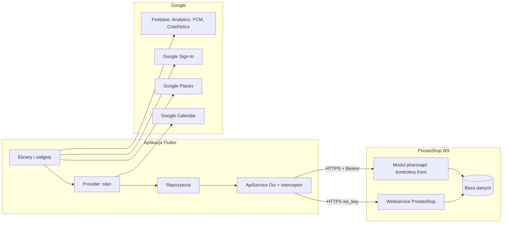
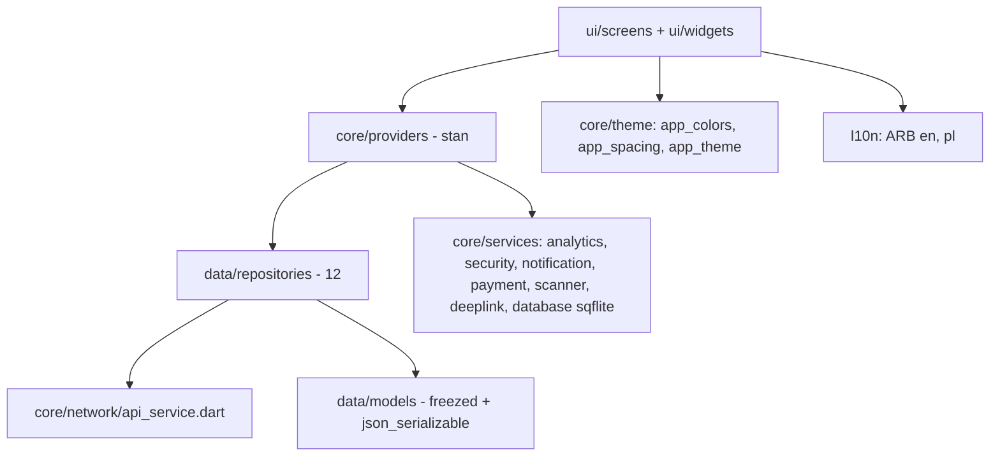
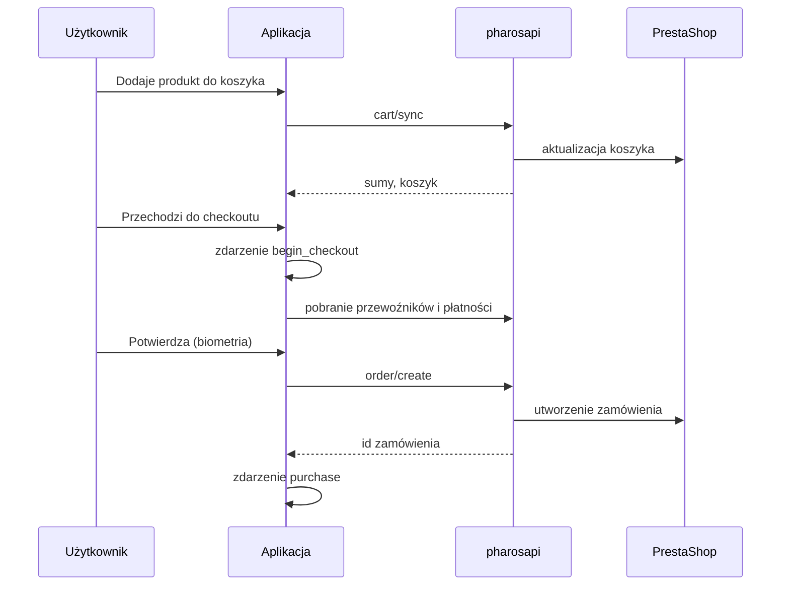
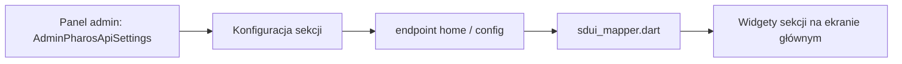

# 02. Architektura systemu

Dane z przeszukania kodu (stan 16.10.2026): 103 pliki Dart w `lib/` (ok. 16,2 tys. linii; po zmianach E4 i E5: 108 plików, ok. 18,2 tys. linii), 21 ekranów, 12 repozytoriów, 10 providerów stanu. Moduł: 16 kontrolerów front i 1 admin, 78 plików PHP w `src/` z kontrolerami, 2 tabele (lista życzeń, tokeny FCM).

## Widok ogólny

## Warstwy aplikacji

Rzeczywista struktura różni się od opisanej w pierwotnym README (Clean Architecture z warstwą `domain/`, BLoC, JWT). W kodzie nie ma katalogu `domain/`, nie ma BLoC (tylko `provider`), a uwierzytelnianie opiera się na kluczu `ws_key` i, od E1, tokenie sesji. README zostanie dostosowane w E6 (plik 09).

## Przepływ zamówienia (sekwencja)

## Strona główna sterowana z serwera (SDUI)

Układ składa `sdui_mapper.dart` z konfiguracji modułu. Pięć typów sekcji: `BannerSlider`, `CategoryChips`, `SectionHeader`, `ProductGrid`, `Recommendations`. Zmiana układu w panelu administratora PrestaShop nie wymaga aktualizacji aplikacji.

## Model danych modułu

Dwie własne tabele: lista życzeń (klient, produkt) oraz tokeny FCM (klient, token urządzenia). Pozostałe dane (koszyki, zamówienia, adresy, opinie) korzystają ze struktur PrestaShop.

## Gdzie wstawić diagramy

Diagram widoku ogólnego do rozdziału "Projekt systemu", sekwencję zamówienia do opisu realizacji checkoutu, SDUI do opisu konfiguracji zaplecza.
