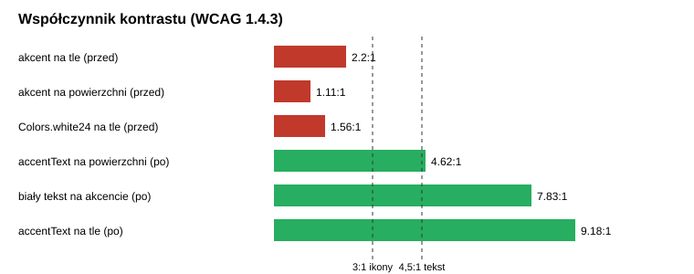

# 04. Audyt interfejsu (stan przed poprawkami)

Audyt statyczny na podstawie kodu `lib/ui/` (35 plików, 6192 linie w ekranach) z 16.10.2026. Kontrast obliczony z tokenów. **Wygląd należy potwierdzić zrzutami z emulatora** (plik 11, sekcja A).

## Metryki wyjściowe

| Wskaźnik | Wartość przed |
|----------|---------------|
| Kontrast akcentu `#80410E` na tle | 2,2:1 (wymagane 4,5:1) |
| Kontrast akcentu na powierzchni | 1,1:1 |
| Użycia akcentu jako koloru tekstu lub ikony | 34 |
| `Semantics` w całym UI | 1, tooltipów 0 |
| Teksty wpisane na sztywno `Text('...')` | 62 (przy 19 użyciach lokalizacji) |
| `Colors.*` | 524 (przy 12 `Theme.of`) |
| Literały `Color(0x...)` | 32 |
| Literały `fontSize` | 120 |
| `fontSize` 9 do 11 | 21 użyć |
| `SizedBox` z liczbą wpisaną na sztywno | 165 |
| Linie ekranu checkoutu | 1157 |
| Pola formularza gościa bez `autofillHints`, `textInputAction` | 7 (0 trafień wzorców) |

## Znaleziska

Skala: krytyczne, istotne, kosmetyczne. Heurystyki wg Nielsena, kryteria wg WCAG 2.1.

### Krytyczne

1. **Akcent ginie na ciemnym tle** (widoczność stanu, WCAG 1.4.3 i 1.4.11). Ikony kroków, obramowania i spinnery. Poprawka: akcent zostaje wypełnieniem przycisku (biały tekst 7,83:1), do tekstu i ikon nowy token `accentText`.
2. **Pasek kroków checkoutu nie mówi, gdzie jestem** (widoczność stanu systemu). Trzy ikony bez etykiet, nieaktywna `Colors.white24` (ok. 1,6 do 2,2:1). Stan zależał od wypełnienia pól, nie od kroku.
3. **Formularz gościa bez wsparcia wpisywania** (zapobieganie błędom, efektywność). Siedem pól wpisywanych ręcznie, Enter nie przechodzi dalej.

### Istotne

4. **Dostępność niemal nie istnieje** (WCAG 4.1.2). Czytnik ekranu nie nazwie ikon.
5. **Teksty poza lokalizacją** (zgodność z rzeczywistością: README obiecuje wielojęzyczność).
6. **Kolory i style poza motywem** (spójność). Zmiana palety wymagałaby edycji kilkuset miejsc.
7. **Checkout w jednej klasie 1157 linii** (efektywność i spójność). Stan łączył logowanie, gościa, adresy, dostawę, płatność i walidację.

### Kosmetyczne

8. Zbyt małe napisy (9 do 11 sp). Minimum 12 sp.
9. Odstępy bez skali. Skala 4, 8, 12, 16, 24, 32.

## Co zadziałało dobrze

Spójny ciemny motyw z brązowym akcentem, stany ładowania (58 użyć shimmer i spinnerów), walidacja przez wspólną klasę `FormValidation`, opcja założenia konta po zakupie.

## Wizualizacja metryk

Zestawienie liczb "przed i po" po poprawkach jest w pliku 05 i 08.

## Mapowanie na rejestr poprawek

| ID | Znalezisko | Etap | Status |
|----|------------|------|--------|
| UI-1 | kontrast akcentu | E2 | zrobione (PR #5) |
| UI-2 | pasek kroków | E4 | zrobione (PR #7) |
| UI-3 | autouzupełnianie | E4 | zrobione (PR #7) |
| UI-4 | dostępność | E5, E5b | zrobione (PR #8), checkout w PR #9 |
| UI-5 | teksty do ARB | E5, E5b | zrobione (PR #8), checkout w PR #9 |
| UI-6 | `Colors.*` na tokeny | E2 | w toku, nie zamknięte |
| UI-7 | podział checkoutu | E4 | zrobione (PR #7) |
| UI-8 | minimalny font 12 sp | E2 | zrobione (PR #5) |
| UI-9 | skala odstępów | E2 | zrobione (PR #5) |
