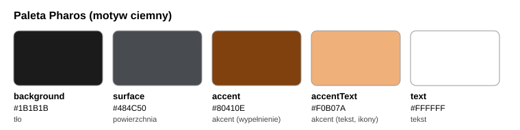

# 05. System designu

System zachowuje tożsamość aplikacji (grafit i brąz) i naprawia jej słabe punkty. Implementacja: `lib/core/theme/app_colors.dart`, `app_spacing.dart`, `app_theme.dart`.

## Kolory

| Token | Wartość | Zastosowanie |
|-------|---------|--------------|
| `background` | `#1B1B1B` | tło ekranów |
| `surface` | `#484C50` | karty, pola |
| `accent` | `#80410E` | wypełnienie przycisku głównego |
| `accentText` | `#F0B07A` | tekst i ikony w kolorze akcentu |
| `text` | `#FFFFFF` | tekst podstawowy |

W specyfikacji zaproponowano `#C9743A` (4,96:1 na tle, ale tylko 2,49:1 na powierzchni). W kodzie zastosowano jaśniejszy `#F0B07A`, który spełnia 4,5:1 także na powierzchni. To uzasadnienie zmiany do opisania w pracy.

## Kontrast (obliczenia wg WCAG)

Wzór: luminancja względna `L = 0,2126 R + 0,7152 G + 0,0722 B` po linearyzacji sRGB, kontrast `(L1 + 0,05) / (L2 + 0,05)`.

| Para | Kontrast | Próg | Wynik |
|------|----------|------|-------|
| akcent na tle (przed) | 2,20:1 | 4,5:1 | niespełnione |
| akcent na powierzchni (przed) | 1,11:1 | 3:1 | niespełnione |
| `Colors.white24` na tle (przed) | 1,56:1 | 3:1 | niespełnione |
| biały tekst na akcencie | 7,83:1 | 4,5:1 | spełnione |
| `accentText` na tle | 9,18:1 | 4,5:1 | spełnione |
| `accentText` na powierzchni | 4,62:1 | 4,5:1 | spełnione |
| biały na tle | 17,22:1 | 4,5:1 | spełnione |

## Typografia (skala)

| Rola | Rozmiar / grubość |
|------|-------------------|
| Tytuł ekranu | 24 / 700 |
| Nagłówek sekcji | 20 / 600 |
| Tekst podstawowy | 16 / 400 |
| Tekst pomocniczy | 14 / 400 |
| Podpis, etykieta pola | 12 / 400 (minimum) |

## Odstępy (dp)

Skala: 4, 8, 12, 16, 24, 32, 40, 48 (stałe `AppSpacing.s4` ... `s48`).

## Zasady komponentów

- Cel dotyku minimum 48 × 48 dp, przycisk główny 52 dp.
- Etykieta pola zawsze widoczna, błąd pod polem tekstem, nie tylko kolorem.
- Jeden przycisk główny na ekran, reszta w stylu drugorzędnym.
- Tekst i ikony w akcencie tylko w odcieniu `accentText`.

## Dostępność (E5 i E5b)

- Etykiety semantyczne i tooltipy dla ikon i przycisków akcji.
- Pasek kroków: czytnik ekranu odczytuje np. "Krok 1 z 3: Adres, bieżący" (klucz `stepSemanticsLabel`, stany `stepDone`, `stepCurrent`, `stepTodo`).
- Teksty w ARB (en i pl), test `l10n_arb_test.dart` pilnuje zgodności kluczy i placeholderów.

## Stan po zmianach

| Wskaźnik | Przed | Po |
|----------|-------|----|
| Kontrast tekstu w akcencie | 2,2:1 | 4,62:1 do 9,18:1 |
| Najmniejszy napis | 9 sp | 12 sp |
| Skala odstępów | brak | stałe `AppSpacing` |
| Klucze lokalizacji | 19 użyć | 186 kluczy w ARB (pl) |
| `Colors.*` w `lib/ui` | 524 | 529 (UI-6 niezamknięte, bez poprawy) |
| `Text('...')` ze stałym tekstem w `lib/ui` | 62 | 20 (do przejrzenia, część to nie teksty użytkownika) |
| `Semantics(` / `tooltip:` w `lib/ui` | 1 / 0 | 5 / 23 |
| `autofillHints` w `lib/` | 0 | 10 |
| Napisy 9 do 11 sp | 21 | 0 |
| `SizedBox` ze stałą liczbą | 165 | 15 (reszta przez `AppSpacing`) |

Pomiar z 18.10.2026 poleceniami `grep` z pliku 08. Kryterium E5 ("0 tekstów na sztywno") nie jest w pełni spełnione: zostało 20 trafień do ręcznego przeglądu. Po kolejnej partii (walidatory i 5 komunikatów ekranów) przeniesiono do ARB część z nich; pozostają komunikaty w providerach (`cart_provider`, `checkout_notifier`, `user_provider`), błędy w `home_screen.dart` i okno płatności testowej w `payment_service.dart`, które nie mają dostępu do kontekstu.
