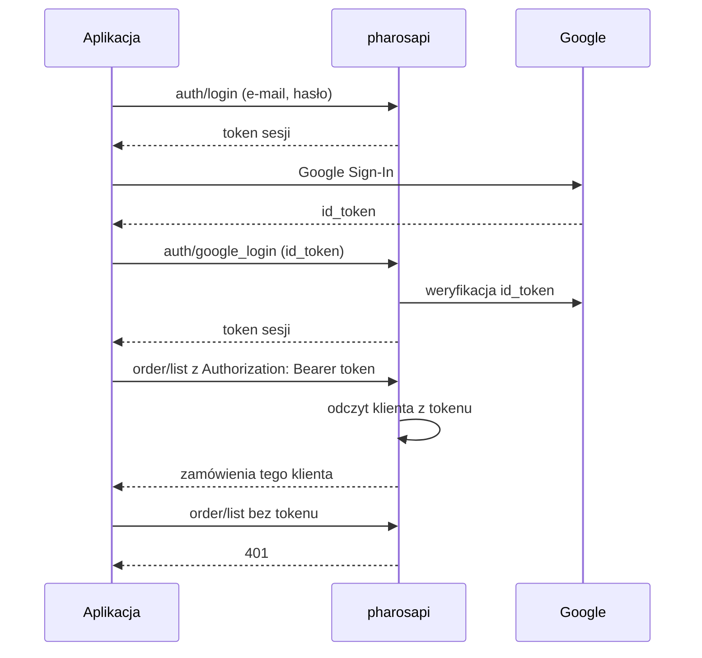
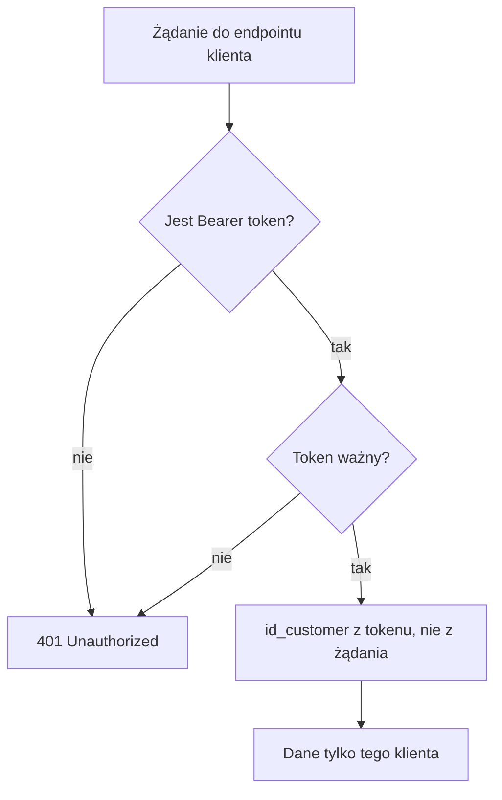

# 06. Bezpieczeństwo

Etap E1 (gałęzie `fix/pharosapi/auth-token` w repo modułu i `fix/app/secure-transport` w aplikacji). Moduł jest w osobnym repozytorium (`Popalacz/Pharos-Api`), PR #1.

## Stan przed (znaleziska)

Numeracja robocza; w rejestrze poprawek pozycje to SEC-1 do SEC-7, a przypisanie numerów do opisów poniżej trzeba sprawdzić w specyfikacji przed cytowaniem.

| Nr | Problem |
|----|---------|
| 1 | Brak uwierzytelnienia klienta: `id_customer` brany z ciała lub zapytania żądania w `order`, `address`, `auth`, `wishlist`, `reviews`. W module 0 trafień JWT i Bearer. Dowolna osoba z kluczem API mogła czytać cudze zamówienia i adresy. |
| 2 | Klucz API wpisany w kod aplikacji. |
| 3 | Wyłączona weryfikacja certyfikatu TLS w `main.dart` i `api_service.dart`. |
| 4 | Logowanie przez Google bez weryfikacji `id_token` po stronie serwera. |
| 5 | Rozproszone listy origin CORS. |
| 6 | Token crona porównywany zwykłym `==`. |
| 7 | Aktywny kontroler `debug` z tokenem w zapytaniu. |

## Poprawki

Moduł (commity w `fix/pharosapi/auth-token`): `feat: add session token storage and bearer auth helpers`, `fix: require session token and verified Google id_token in auth controller`, `fix: bind order and address endpoints to the authenticated customer`, `fix: use session customer in wishlist, reviews and cart sync`, `fix: harden cron token check and unify CORS origin handling`, `fix: resolve FCM token owner from bearer session`, `test: cover bearer auth gate and customer id source`.

Aplikacja (PR #4): usunięcie obejścia TLS i domyślnego klucza API, wysyłanie `Authorization: Bearer` oraz `id_token` Google.

## Przepływ autoryzacji po zmianach

## Reguła dostępu

## Weryfikacja

- Test PHPUnit w module: bramka bearer i źródło `id_customer` (`test: cover bearer auth gate and customer id source`).
- **Nie wykonano** testu na prawdziwej instalacji PrestaShop (TEST-2) ani testu, że klient A nie odczyta danych klienta B w środowisku z bazą.

## Ryzyka wdrożeniowe (do opisania uczciwie)

1. Nagłówek `Authorization` może być odcinany przez Apache/FastCGI bez reguły w `.htaccess`.
2. Status zamówienia `PS_OS_PAYMENT` do potwierdzenia na docelowym sklepie.
3. Rotacja `ws_key` i unieważnienie klucza Google, który był w repozytorium (klucz pozostaje w historii git).
4. Zabezpieczenie koszyka gościa.
5. Moduł (wersja 1.0.2) trzeba wdrożyć **przed** aplikacją, bo nowa aplikacja zakłada uwierzytelnianie tokenem po stronie serwera.
