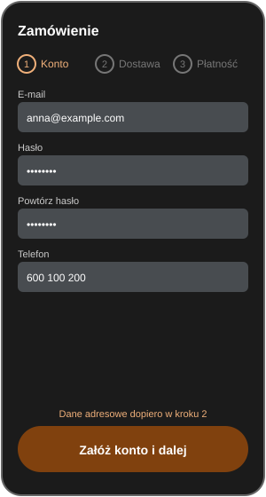
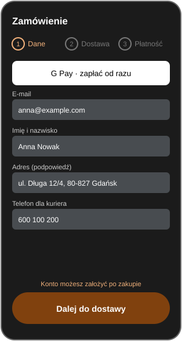
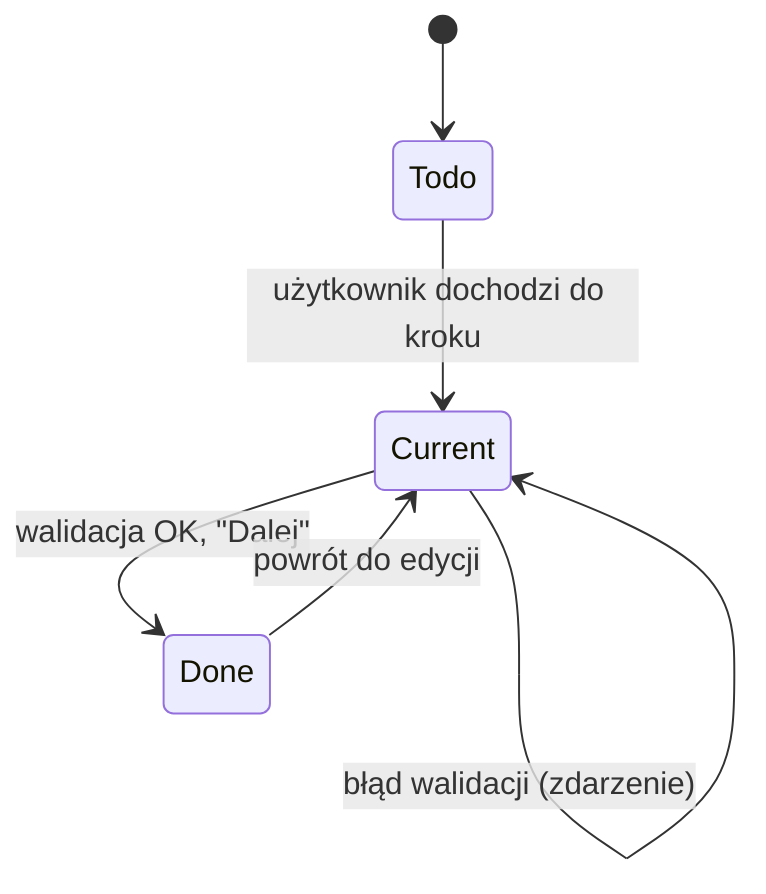
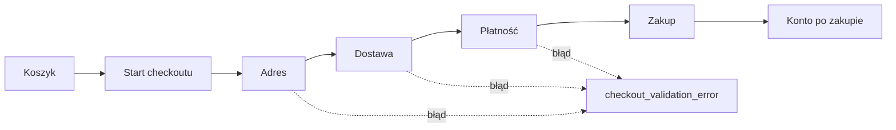
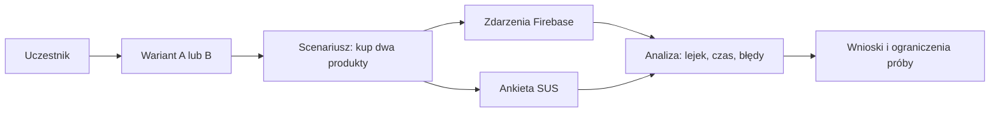

# 07. Checkout w dwóch wariantach i eksperyment

## Wariant A i B

W kodzie (`lib/ui/screens/checkout/checkout_variant.dart`):

- **A (`single`)**: jedna strona ze wszystkimi sekcjami.
- **B (`stepped`)**: kroki jeden po drugim (Adres, Dostawa, Płatność), z podpisanym paskiem kroków.

Makiety projektowe (specyfikacja) opisują wariant A jako formularz z kontem wymaganym, a B jako zakup gościa z szybką płatnością. Implementacja różni się: oba warianty mają zakup gościa, różnią się układem (strona vs kroki). **W pracy opisz wariant tak, jak jest w kodzie**, a makiety potraktuj jako projekt koncepcyjny.

| Cecha | A | B |
|-------|---|---|
| Układ | jedna strona | trzy kroki |
| Pasek kroków | tak (podpisy, 3 stany) | tak (podpisy, 3 stany) |
| Zakup jako gość | tak | tak |
| Konto po zakupie | tak (ekran potwierdzenia) | tak (ekran potwierdzenia) |

 

Stan faktyczny przełącznika wariantu: `AnalyticsService.checkoutVariant` jest ustawiane z `CheckoutVariant`, domyślnie `A`. **Przełączanie przez Remote Config nie jest jeszcze podłączone** (zadanie otwarte), więc przydział do grup trzeba zrobić ręcznie albo dokończyć mechanizm przed eksperymentem.

## Stany pojedynczego kroku

## Ścieżka zakupu

## Instrumentacja lejka (Firebase Analytics)

Każde zdarzenie niesie parametr `checkout_variant` (A lub B).

| Zdarzenie | Kiedy | Parametry |
|-----------|-------|-----------|
| `view_cart` | podgląd koszyka | `value`, `item_count`, `currency` |
| `begin_checkout` | start checkoutu | `value`, `currency`, `is_guest` |
| `checkout_step_complete` | ukończony krok | `step` (`address`, `shipping`, `payment`) |
| `checkout_validation_error` | błąd walidacji | `reason`, `field_count` |
| `purchase` | zamówienie złożone | `transaction_id`, `value`, `currency`, `is_guest` |
| `account_created_after_purchase` | konto po zakupie | `transaction_id` |

Test jednostkowy: `test/unit/analytics_service_test.dart`. **Weryfikacja w Firebase DebugView nie została wykonana** (kryterium odbioru E3 otwarte).

## Plan eksperymentu (E7, nie wykonany)

| Element | Ustalenie |
|---------|-----------|
| Scenariusz | "Kup dwa produkty" |
| Grupy | dwie, po jednej na wariant, przydział losowy |
| Liczebność | do ustalenia z promotorem (próba mała, więc wyniki opisowe, nie istotność statystyczna) |
| Metryki | ukończenie zakupu, czas do zamówienia (różnica znaczników zdarzeń), liczba błędów walidacji, SUS, odsetek kont po zakupie |
| Narzędzia | Firebase Analytics, ankieta SUS (10 pytań) |

| Miara | Hipoteza |
|-------|----------|
| Ukończenie zakupu | B > A |
| Czas do zamówienia | B < A |
| Błędy walidacji | B < A |
| SUS | B > A |
| Konta po zakupie | B zbliżone do A |

### Obliczanie SUS

Dla pozycji nieparzystych (1, 3, 5, 7, 9): wynik minus 1. Dla parzystych: 5 minus wynik. Suma × 2,5 daje 0 do 100. Próg "dobry" ok. 68 (Brooke, 1996; Sauro i Lewis).

## Co trzeba dopisać po eksperymencie

Wyniki liczbowe obu grup, wykres lejka (liczba zdarzeń na kroku, A vs B), tabela SUS, opis ograniczeń (mała próba, znajomość aplikacji, scenariusz laboratoryjny).
