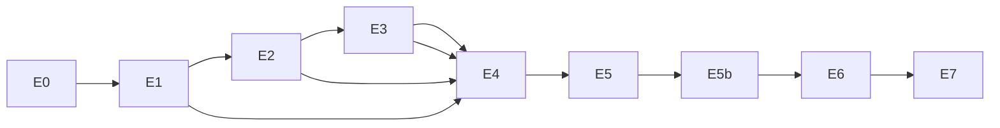
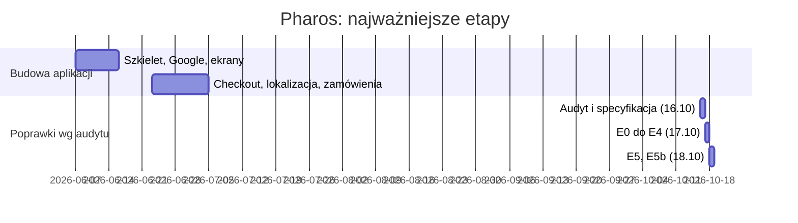

# 09. Proces wytwórczy

## Git flow

Każdy etap to osobna gałąź z `main` i osobny pull request. Na `main` nie trafia nic bez przeglądu innej osoby (zasada firmowa Arkonsoft). Commity: `<typ>: <opis>`, jedna linia, angielski. Moduł PrestaShop jest w osobnym repozytorium (`Popalacz/Pharos-Api`).

## Etapy i pull requesty

| Etap | Zakres | Gałąź | PR | Status |
|------|--------|-------|----|--------|
| E0 | Porządek w repozytorium (269 niezacommitowanych zmian) | `chore/repo/cleanup` | #3 | scalony |
| E1 | Bezpieczeństwo modułu i aplikacji | `fix/pharosapi/auth-token`, `fix/app/secure-transport` | Pharos-Api #1, Pharos #4 | aplikacja scalona, moduł do przeglądu |
| E2 | Tokeny motywu i kontrast | `feat/app/design-tokens` | #5 | scalony |
| E3 | Analityka lejka | `feat/app/funnel-analytics` | #6 | scalony |
| E4 | Checkout w dwóch wariantach | `feat/app/checkout-variants` | #7 | scalony |
| E5 | Dostępność i lokalizacja ekranów | `fix/app/a11y-l10n` | #8 | scalony |
| E5b | Lokalizacja i dostępność checkoutu | `fix/app/a11y-l10n-checkout` | #9 | otwarty |
| docs | Materiały do pracy (ten folder) | `docs/app/inzynierka` | #10 | otwarty |
| E6 | Testy, porządek, dokumentacja | `chore/app/tests-docs` | #11 | otwarty |
| E7 | Eksperyment i opis w pracy | poza kodem | - | przed |

Kolejność E1, E2, E3 jest wiążąca: E4 korzysta z tokenu logowania, tokenów motywu i zdarzeń lejka.

## Oś czasu

Historia: 47 commitów na `main`; pierwsze 2026-06-07, ostatnie (E5) 2026-10-18.

## Nakłady (szacunki z planu)

| Etap | Nakład | Szacunek tokenów |
|------|--------|------------------|
| E0 | S | 20 do 30 tys. |
| E1 | L | 120 do 180 tys. |
| E2 | M | 60 do 100 tys. |
| E3 | M | 40 do 70 tys. |
| E4 | L | 150 do 250 tys. |
| E5 | L | 100 do 180 tys. |
| E6 | M | 80 do 140 tys. |
| Razem E0 do E6 | | 575 do 950 tys. |

To szacunki planistyczne, nie pomiar. Wpisz je w pracy jako oszacowanie nakładu z użyciem narzędzi AI, jeśli promotor się zgodzi.

## Użycie narzędzi AI (do decyzji autorki)

Kod, testy i dokumentacja etapów E0 do E6 powstawały z udziałem asystenta AI (Claude Code), pod nadzorem autorki. Commity i PR są opublikowane pod kontem autorki bez znacznika narzędzia. Forma ujawnienia w pracy: do ustalenia z promotorem i regulaminem uczelni.

## Dla pracy

Diagram etapów i oś czasu do rozdziału o organizacji pracy. Zrzut listy PR z GitHuba (plik 11, sekcja E).
