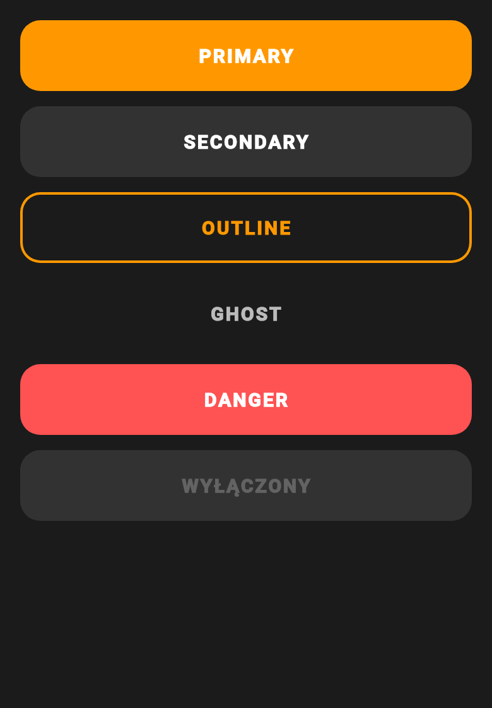
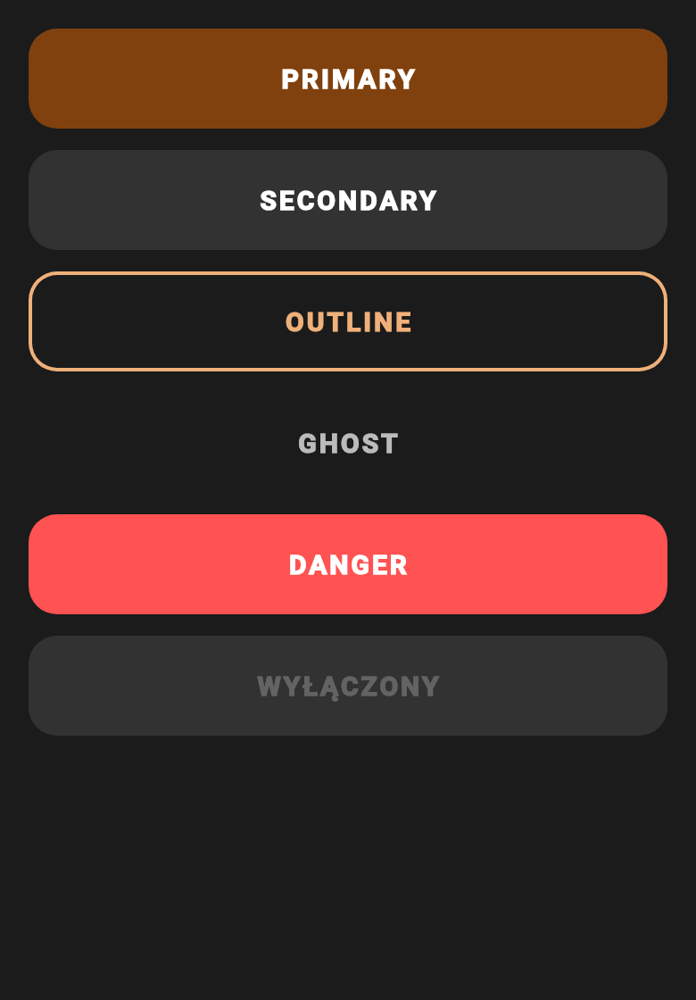
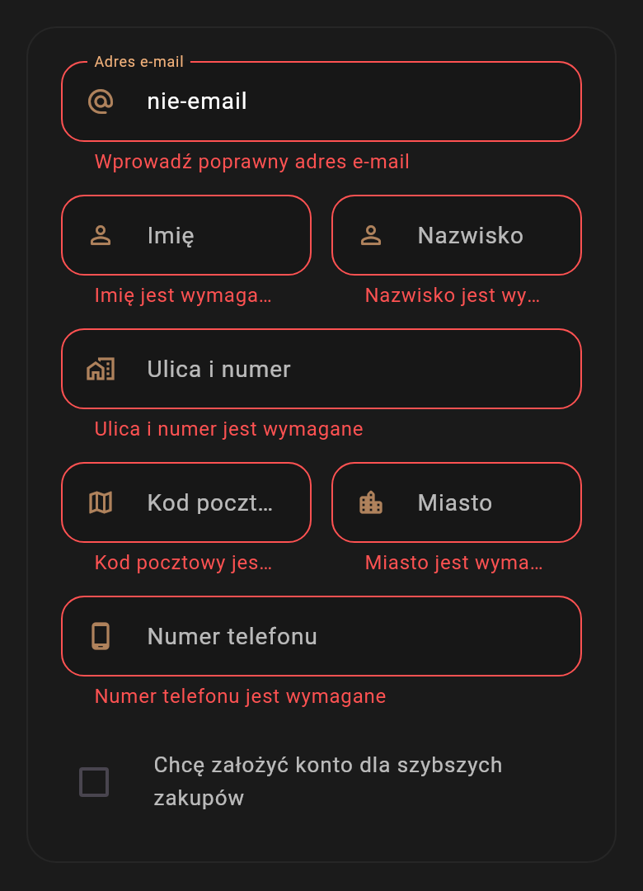
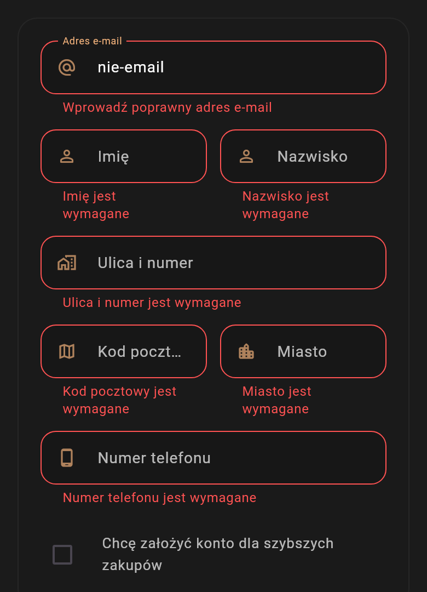

# 11. Zdjęcia i wizualizacje

## Gotowe grafiki (w `images/`)

| Plik | Do czego |
|------|----------|
| `paleta.svg` | paleta kolorów (plik 05) |
| `kontrast.svg` | wykres kontrastu przed i po (pliki 04 i 05) |
| `makieta-wariant-A.svg` | makieta wariantu A (plik 07) |
| `makieta-wariant-B.svg` | makieta wariantu B (plik 07) |

Diagramy Mermaid są w plikach 02, 06, 07 i 09 (eksport opisany w README).

## Renderowane z kodu: przed i po (gotowe, w `images/`)

Generuje je `tool/render_screens_test.dart`: prawdziwe widżety checkoutu i przyciski w motywie Pharos, czcionka Roboto, rozdzielczość 2x. Zmienna `RENDER_PREFIX` ustawia przedrostek pliku. Pliki `przed-*` powstały z `main` sprzed PR #12 i #13, pliki `po-*` z kodu z tymi PR. To **render widżetów, nie zrzuty z urządzenia**, więc w pracy opisz je jako "widok komponentu". Nie zastępują zrzutów A..C poniżej. Skrypt używa kodu aplikacji, więc po zmianach w UI uruchom go ponownie.

| Plik (przed i po) | Co pokazuje | Co się zmieniło |
|-------------------|-------------|-----------------|
| `przed-przyciski.png`, `po-przyciski.png` | pięć stylów `PharosButton` i stan wyłączony | tło głównego przycisku z pomarańczowego `#FF9800` na akcent `#80410E` (biały tekst ok. 8:1, wcześniej ok. 2:1), obrys i tekst `outline` na `accentText` |
| `przed-pasek-krok1.png` do `-krok3.png`, `po-pasek-krok1.png` do `-krok3.png` | pasek kroków (bieżący, ukończony z ptaszkiem, do wykonania) | bez zmian wizualnych, pokazuje stany z podpisami |
| `przed-formularz-pusty.png`, `po-formularz-pusty.png` | formularz gościa | ujednolicone kolory z tokenów |
| `przed-formularz-bledy.png`, `po-formularz-bledy.png` | błędy walidacji pod polami | przed: komunikaty w kolumnach ucięte (`Imię jest wymaga…`), po: pełny tekst (`errorMaxLines: 3`), jeden kolor błędu `#FF5252` |
| `przed-platnosc-wybrana.png`, `po-platnosc-wybrana.png` | lista metod płatności z wybraną kartą | akcent z tokenów |

 
 

**Znalezisko z renderu (do opisania jako ograniczenie):** biały tekst na przycisku `danger` (`#FF5252`) ma kontrast ok. 3:1, poniżej progu 4,5:1 dla zwykłego tekstu. Do poprawy (ciemniejsze tło przycisku, np. `#C62828`).

## Zrzuty do wykonania (nie istnieją jeszcze)

Zrzuty z emulatora lub telefonu. Nazwy plików do `inzynierka/images/`. Android: `adb exec-out screencap -p > nazwa.png`, albo przycisk aparatu w emulatorze.

### A. Interfejs, stan przed (z commita sprzed E2, `9e6da7a` lub `1b9235f`)

Wykonaj na starszej wersji (`git checkout 1b9235f` w osobnym katalogu), żeby pokazać problemy z audytu.

| Plik | Ekran | Co ma być widać |
|------|-------|-----------------|
| `przed-checkout-pasek.png` | checkout | trzy ikony bez etykiet, szare nieaktywne |
| `przed-checkout-formularz.png` | checkout, gość | siedem pól bez podpowiedzi |
| `przed-akcent-ikony.png` | dowolny z ikonami w akcencie | słaby kontrast |
| `przed-koszyk.png` | koszyk | stan wyjściowy |

### B. Interfejs, stan po (obecny `main`)

| Plik | Ekran | Co ma być widać |
|------|-------|-----------------|
| `po-checkout-A.png` | checkout wariant A | jedna strona |
| `po-checkout-B-krok1.png`, `-krok2.png`, `-krok3.png` | checkout wariant B | pasek z podpisami, trzy stany |
| `po-checkout-blad.png` | checkout | błąd pod polem tekstem |
| `po-checkout-en.png` | checkout w języku angielskim | zlokalizowane teksty |
| `po-home.png`, `po-katalog.png`, `po-produkt.png`, `po-koszyk.png`, `po-potwierdzenie.png` | pozostałe ekrany | spójność motywu |

### C. Dostępność

| Plik | Co |
|------|----|
| `a11y-talkback-pasek.png` | TalkBack z fokusem na pasku kroków ("Krok 1 z 3: Adres, bieżący") |
| `a11y-semantics-debugger.png` | `showSemanticsDebugger: true` na checkoucie |
| `a11y-cel-dotyku.png` | nakładka Layout Inspector z celami 48 dp |

### D. Testy i narzędzia

| Plik | Co |
|------|----|
| `test-flutter-test.png` | wynik `flutter test` w terminalu |
| `test-analyze.png` | wynik `dart analyze` |
| `test-phpunit.png` | wynik PHPUnit w module |
| `firebase-debugview.png` | zdarzenia lejka w DebugView (po E3, wymaga urządzenia) |
| `firebase-funnel.png` | lejek A vs B po eksperymencie (E7) |

### E. Proces

| Plik | Co |
|------|----|
| `github-pr-lista.png` | lista pull requestów #1 do #9 |
| `github-pr-review.png` | przykładowy przegląd PR |
| `git-graph.png` | wynik `git log --graph --oneline` |

### F. Zaplecze

| Plik | Co |
|------|----|
| `prestashop-bo-modul.png` | konfiguracja modułu w panelu administratora |
| `prestashop-sdui-sekcje.png` | konfiguracja sekcji strony głównej |
| `home-sdui-wynik.png` | efekt w aplikacji |

### G. Eksperyment (E7)

Fotografie lub zrzuty stanowiska badania (bez twarzy uczestników), formularz SUS, wykres wyników.

## Wskazówki

- Jedno urządzenie i rozmiar ekranu do wszystkich zrzutów (np. 1080 × 2400), motyw ciemny.
- Zrzuty bez danych osobowych (testowy adres e-mail, np. anna@example.com).
- Podpisz każdy rysunek w pracy numerem i opisem, w tekście odwołuj się do numeru.
